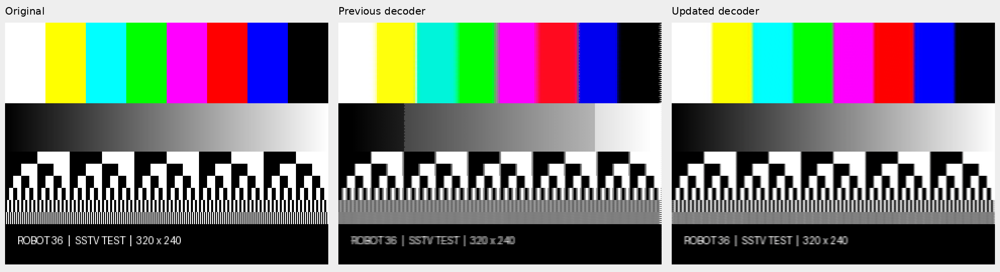
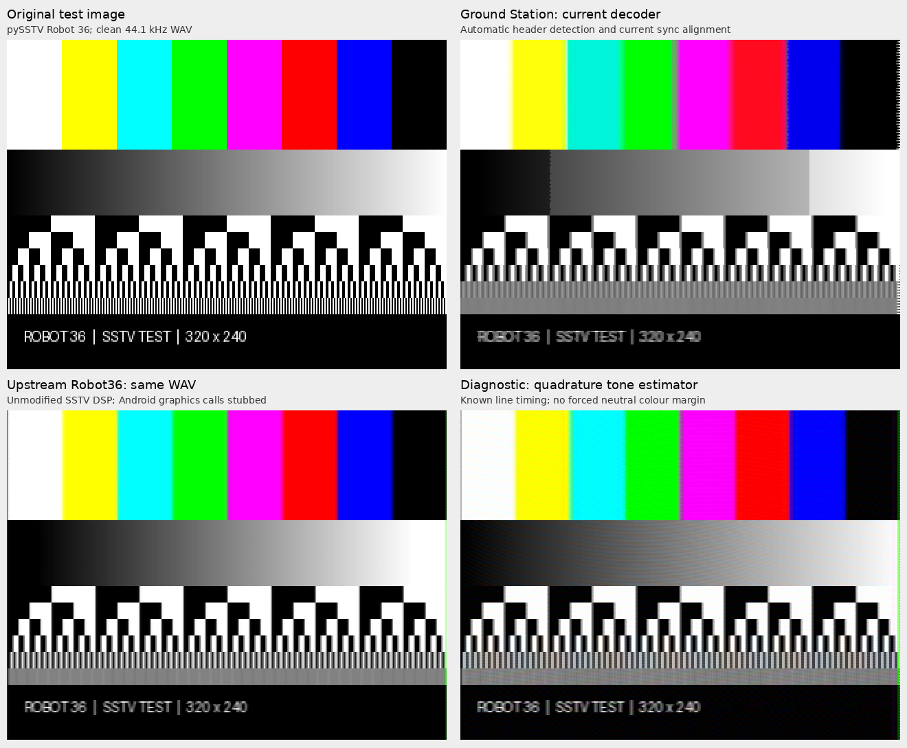

# SSTV decoder review

Initial review on 2026-10-27 against Ground Station commit `12887e51cddf2d7729ef05a279702141c16080a6`. The findings below describe that original implementation.

## Applied improvements

Following the review, the working tree now includes continuous audio-tone demodulation, qualified sync detection, Robot sample-clock estimation, separator-driven Cr/Cb pairing, and full-width chroma reconstruction. Scan-edge tones are continued before filtering so porches and sync pulses do not contaminate the last colour pixels.

The IQ path now preserves tuning phase, decimation phase, resampler history and fractional timing. Its declared decimation factor matches the applied stages. Receiver reconfiguration or missing IQ chunks reset capture state, and broadcast FM de-emphasis has been removed from this data path.

Frame decoding runs on an isolated worker snapshot while the decoder process continues to ingest IQ. Audio arriving during image processing is retained, and a receiver reset cancels or discards the old frame's result.

Robot capture uses its 36-second layout, adjusted for the measured transmitter clock, and retains trailing audio for the following image. Invalid VIS parity or stop tones are rejected. Forced Robot 36 can also acquire a repeated sync train without a VIS header. The frontend now selects a 12.5 kHz RF bandwidth for SSTV, matching the backend defaults.



On the same pySSTV-generated 44.1 kHz recording, image PSNR increased from 13.80 to 16.96 dB. Current automatic acquisition and decoding took approximately 0.93 seconds locally. These are synthetic diagnostics; reception testing remains necessary.

Regression coverage includes clean/noisy Robot pictures, tone offsets, clock error, missing sync, an omitted line, final-column colour, consecutive frames, headerless forced acquisition, damaged VIS framing, arbitrary IQ/resampler chunk boundaries, receiver rate changes, and Martin/Scottie colour-channel layout. See `backend/tests/testsstvdecoder.py`.

Validation: 40 focused backend tests and 6 frontend decoder-parameter tests passed. A complete generated Robot 36 picture also decoded through the RF FM path at 240 ksample/s with a 12,345 Hz carrier offset and irregular IQ chunks.

For reception testing, restart the backend and reselect SSTV so the VFO uses the new 12.5 kHz bandwidth. Existing persisted VFO settings may still contain the old 3.3 kHz value.

## Assessment

The decoder has the correct basic Robot 36 line layout and can recover recognisable pictures, but several implementation choices reduce detail and robustness. Clean synthetic audio reproduces the loss, so reception conditions cannot explain all of it.

The strongest evidence is a biased pixel-frequency estimator, unnecessarily broad chroma windows, weak sync validation, and explicitly overwritten right-edge colour. Separate defects in the IQ-to-audio path can add noise or change the apparent sample clock. The current automated SSTV tests exercise configuration and progress reporting, not image decoding.

Only Robot 36 is implemented. Robot 72 and the other Robot variants are unsupported.



The bottom-right panel is a diagnostic experiment with known line positions, not a complete replacement decoder. The upstream Robot36 panel was produced by running its Java decoder core on the same WAV.

## Reference projects inspected

| Project | Relevance | What was checked |
| --- | --- | --- |
| [xdsopl/robot36](https://github.com/xdsopl/robot36) | Established Android decoder; strongest reference for a continuous audio demodulator and Robot colour identification | Ran the decoder core on the generated Robot 36 WAV; inspected demodulation, pulse validation, line timing, colour pairing and frequency correction |
| [ON4QZ/QSSTV](https://github.com/ON4QZ/QSSTV) | Desktop SSTV transmitter/receiver with Robot support | Inspected Robot line state machine, separator-tone checks, colour conversion and clock/slant estimation; application was not built |
| [colaclanth/sstv](https://github.com/colaclanth/sstv) | Compact Python decoder supporting Robot 36/72 and several RGB modes | Inspected decoding and mode definitions; much of Ground Station's decoding algorithm closely matches this implementation, so it is not an independent validation of that algorithm |
| [dnet/pySSTV](https://github.com/dnet/pySSTV) | Independent transmitter for controlled input | Used its Robot 36 encoder to create the clean WAV; this project is an encoder, not a decoder |

Pinned source versions and useful files:

- Robot36 `2af2390954aa248725042ba6b1332bbcca68c357`: [Demodulator.java](https://github.com/xdsopl/robot36/blob/2af2390954aa248725042ba6b1332bbcca68c357/app/src/main/java/xdsopl/robot36/Demodulator.java), [Robot_36_Color.java](https://github.com/xdsopl/robot36/blob/2af2390954aa248725042ba6b1332bbcca68c357/app/src/main/java/xdsopl/robot36/Robot_36_Color.java), [Decoder.java](https://github.com/xdsopl/robot36/blob/2af2390954aa248725042ba6b1332bbcca68c357/app/src/main/java/xdsopl/robot36/Decoder.java), [ColorConverter.java](https://github.com/xdsopl/robot36/blob/2af2390954aa248725042ba6b1332bbcca68c357/app/src/main/java/xdsopl/robot36/ColorConverter.java).
- QSSTV `c9c9d995a97bfb10f805fd39a1b174698e0889e8`: [moderobot1.cpp](https://github.com/ON4QZ/QSSTV/blob/c9c9d995a97bfb10f805fd39a1b174698e0889e8/src/sstv/modes/moderobot1.cpp), [modebase.cpp](https://github.com/ON4QZ/QSSTV/blob/c9c9d995a97bfb10f805fd39a1b174698e0889e8/src/sstv/modes/modebase.cpp), [syncprocessor.cpp](https://github.com/ON4QZ/QSSTV/blob/c9c9d995a97bfb10f805fd39a1b174698e0889e8/src/sstv/syncprocessor.cpp).
- Python decoder `3e556eee8ad4c4425799cb652bac26ee58f8e113`: [decode.py](https://github.com/colaclanth/sstv/blob/3e556eee8ad4c4425799cb652bac26ee58f8e113/sstv/decode.py), [spec.py](https://github.com/colaclanth/sstv/blob/3e556eee8ad4c4425799cb652bac26ee58f8e113/sstv/spec.py).
- pySSTV `c264d6a3c198af852d87df8af737ffb1443f610e`: [color.py](https://github.com/dnet/pySSTV/blob/c264d6a3c198af852d87df8af737ffb1443f610e/pysstv/color.py).

The Robot36 core was compiled locally with a small command-line WAV adapter and stubs for Android graphics classes. The SSTV DSP classes were unchanged. No Android application build or GUI integration was involved. The Python reference could not be run directly because `soundfile` is absent from the backend environment; it was reviewed from source.

## How Robot 36 decoding works

For this project's satellite FM reception, two frequency-demodulation operations serve different purposes:

1. Tune and channel-filter the complex SDR samples, then demodulate the RF FM carrier into audio.
2. Recover the instantaneous frequency of the SSTV audio tone. This tone's frequency encodes brightness or a colour-difference value.

The calibration header contains 1900 Hz leaders and a 1200 Hz break. The VIS field identifies the mode using seven bits sent least-significant bit first, an even-parity bit, and start/stop tones. VIS data tones are 1100 and 1300 Hz.

A Robot 36 picture has 320 × 240 output pixels. Each transmitted line lasts 150 ms:

| Segment | Duration | Meaning |
| --- | --- | --- |
| Sync | 9 ms | 1200 Hz timing reference |
| Sync porch | 3 ms | 1500 Hz |
| Y scan | 88 ms | Full line brightness |
| Colour identification | 4.5 ms | 1500 Hz for the Cr/R−Y line, 2300 Hz for the Cb/B−Y line |
| Chroma porch | 1.5 ms | 1900 Hz |
| Chroma scan | 44 ms | One colour-difference channel |

The first line carries Y and Cr; the next carries its own Y and Cb. Two adjacent lines provide the two colour channels for reconstruction. The line pair shares chroma vertically. The shorter chroma scan also limits horizontal colour detail. Robot 36 cannot preserve all the detail of a 320 × 240 RGB original.

The picture portion lasts exactly 36 seconds. The audio frequency scale is nominally 1500–2300 Hz, corresponding to channel values 0–255 in the full-range convention used by pySSTV and QSSTV's conversion path.

A receiver needs stable frequency estimates, accurate line positions, detection of which colour channel arrived, and controlled recovery from missing/noisy pulses. Merely finding the strongest spectral component does not provide those guarantees.

## Findings, in recommended repair order

### 1. Pixel frequency estimation distorts clean tones and removes detail

Location: `backend/demodulators/sstvdecoder.py:540`, `:549`, `:675`, `:722`, `:768`.

Robot 36's Y pixel duration is 0.275 ms. Multiplying it by `window_factor = 7.70` produces a 93-sample window at 44.1 kHz: about 2.11 ms, spanning 7.7 luminance pixels. The FFT bin spacing is about 474 Hz.

Interpolation can estimate a steady tone between FFT bins, but the current three-bin barycentric formula is substantially biased for these Hann-windowed samples. Testing 16 phases of each clean sinusoid gave:

| True frequency | Mean estimated frequency | Expected channel byte | Actual byte |
| --- | --- | --- | --- |
| 1600 Hz | 1551.2 Hz | 32 | 16 |
| 1700 Hz | 1754.6 Hz | 64 | 81 |
| 1900 Hz | 1899.2 Hz | 128 | 127 |
| 2100 Hz | 2043.4 Hz | 191 | 173 |
| 2200 Hz | 2246.9 Hz | 223 | 238 |

This is a nonlinear brightness/chroma error. It can create visible steps in gradients and shift hue even with no noise or tuning error.

The chroma scan is sampled at only 160 positions and uses the same 93-sample window. The Python reference samples it at 320 positions with roughly a 47-sample window. Ground Station therefore doubles the reference's chroma observation time and adds further colour smoothing. Rendering with `x // 2` also produces nearest-neighbour colour expansion.

Every pixel FFT searches the entire spectrum. DC, interference or noise outside the useful tone band can win. Missing signal can consequently become extreme channel values.

Recommended direction: band-limit/downconvert SSTV audio and recover a continuous tone-frequency stream with a phase discriminator, then use appropriate smoothing and pixel integration. Robot36 demonstrates this architecture. Preserve FFT analysis for long header tones if useful. A smaller interim improvement is a validated Hann-compatible estimator with denser FFT sampling and a constrained search band; simply shrinking the FFT window is not enough.

### 2. IQ processing does not preserve stream continuity

Location: `sstvdecoder.py:290`, `:1191`, `:1224`.

The frequency translator starts its oscillator at sample zero for every chunk. An offset carrier therefore develops a phase discontinuity at chunk boundaries. In a controlled 1 MHz example with a 12,345 Hz offset and 16,384-sample chunks, splitting an otherwise continuous carrier introduced a 1.637-radian phase jump. The filters and FM discriminator can turn these jumps into periodic audio disturbances.

Decimation also restarts its sample selection at `filtered[::stage_decimation]` for every chunk. Filter state is retained, but the decimator's sampling phase is not. The audio conversion then independently applies FFT resampling to each chunk and truncates its output length. This loses fractional sample-clock state and treats each chunk as a periodic signal, with possible boundary artifacts.

For example, at 1 MHz with decimation by 5 and 16,384-sample chunks, the code emits 722 audio samples per chunk instead of an average 722.5344: approximately −740 ppm. The amount depends on sample rate and chunk size.

These are demonstrated continuity/counting problems; their contribution to any particular saved image depends on that recording's rates, offsets and chunk boundaries.

Recommended direction: persistent tuning phase, persistent decimation phase, a streaming resampler that retains filter history and fractional timing, and explicit handling of gaps using the stream sample counters already supplied by workers.

### 3. Some SDR rates use the wrong decimation factor

Location: `sstvdecoder.py:298`, `:315`, `:1159`, `:1202`.

For more than tenfold decimation, the stage factors are 5 and `total_decimation // 5`, but downstream code still uses the original `total_decimation`.

| SDR rate | Reported factor | Applied factor | Reported / actual intermediate rate |
| --- | --- | --- | --- |
| 2.048 MHz | 10 | 10 | 204.8 / 204.8 kHz |
| 2.4 MHz | 12 | 10 | 200 / 240 kHz |
| 3.2 MHz | 16 | 15 | 200 / 213.33 kHz |

The resulting audio-rate assumptions are wrong. At 2.4 MHz, an actual 1900 Hz tone would nominally appear near 1583 Hz when interpreted at the declared audio rate. This can prevent header detection altogether. It affects all modes, even though Robot was the motivation for this review.

Use the product of the applied stages as the authoritative factor, or choose stage factors whose product equals the requested factor.

### 4. Sync alignment does not establish that a sync pulse exists

Location: `sstvdecoder.py:629`, `:747`.

The search stops when an FFT peak exceeds 1350 Hz. It does not first require a 1200 Hz interval, validate pulse width, constrain the search around a predicted line boundary, or report failure when no qualifying transition was found.

A one-second constant 1900 Hz input returns a supposed sync start at sample −119. A constant 1200 Hz input also returns a position, near the end of the buffer, even though no end-of-sync transition occurred.

On the clean synthetic picture, detected line starts varied from the true positions by 0–0.59 ms, up to about 2.1 luminance pixels or 4.3 full-width chroma sample intervals. The error depended on picture content.

Robot36 instead uses a continuous frequency trace, smoothing, hysteresis, pulse-width/frequency checks, and recent line intervals. QSSTV also fits timing/clock corrections from sync observations.

Recommended direction: detect qualified pulses within a bounded search, track fractional line timing and clock drift, and explicitly distinguish valid sync, predicted timing and loss of lock.

### 5. Robot colour identification is ignored

Location: `sstvdecoder.py:816`.

The renderer assigns Cr/Cb solely from the output row number. It never reads the 1500/2300 Hz identification tone. If capture loses or skips a line, the decoder cannot use those tones to recover the correct colour pairing.

This is a robustness defect, not evidence that every normally aligned image has its channels reversed. The normal first-line Cr / second-line Cb order is correct.

Robot36 reads the identification segment, classifies the channel, and falls back to alternating only when the separator is ambiguous. QSSTV also examines these tones.

### 6. Right-edge colour is deliberately overwritten

Location: `sstvdecoder.py:763`, `:813`.

The last roughly four chroma samples are set to 128 during sampling. The renderer separately sets its current chroma component to 128 for the last three chroma positions, corresponding to six output columns.

This does not consistently neutralize both channels because the complementary component is still read from a neighbouring row. A controlled solid-red channel array rendered as RGB (254, 0, 0) at x=313 but (76, 90, 0) at x=314–319.

Replace the masking with correct segment bounds, filter-delay compensation and edge handling. The margin currently conceals boundary problems while creating its own visible stripe.

### 7. Capture duration and following-frame handling are incorrect

Location: `sstvdecoder.py:1303`, `:1333`.

The generic duration calculation treats both Robot channels as full-length scans. It computes 46.56 seconds rather than 36, requests 51.56 seconds including padding, and uses a 56.56-second timeout after mode acquisition.

Use the mode's declared `height * line_time` as the basis for Robot 36. A modest, deliberate filter/lookahead margin can be added separately.

After decoding, the existing audio buffer is replaced with `next_decode_buffer`. Since decoding is synchronous in this same loop, it does not ingest new audio while `processing` is true. Already captured audio after the first frame can therefore be discarded, and the IQ queue can accumulate while image processing runs. The excessive capture duration increases the opportunity to consume the next transmission's header.

### 8. Acquisition and channel configuration need tightening

Location: `sstvdecoder.py:582`, `:603`, `:1150`; `frontend/src/components/waterfall/vfo-settings/vfo-mode-selectors.jsx:311`.

- Header detection uses fixed nominal tones with ±25 Hz tolerance and does not estimate an audio-tone offset. Robot36 measures frequency correction from the leader/sync tones.
- A VIS parity error is logged but the mode is accepted if its seven data bits match a supported mode. Start/stop validity and signal confidence are not fully checked.
- Forced mode bypasses VIS interpretation but still requires the calibration header. It cannot acquire an in-progress picture by line timing.
- Selecting SSTV in the frontend sets a 3300 Hz bandwidth, while the registry and scheduler use 12,500 Hz. This decoder consumes RF IQ directly: audio bandwidth and RF channel bandwidth need distinct treatment. Its filter cutoff clamp makes the exact effect sample-rate dependent, so 3300 Hz is not always the actual passband.
- Filters are initialized only on the first IQ message. A later SDR rate change is not handled as a fresh DSP configuration in this class.
- Broadcast-FM-style 75 µs de-emphasis is always enabled. It changes tone amplitudes and transition behaviour, but the clean-audio measurements already demonstrate defects without it. Review it against the actual transmitter's pre-emphasis rather than treating its removal as a proven cure.

## What the experiment established

The input was a 320 × 240 test image containing colour bars, a grayscale gradient, text, and stripes of decreasing width. pySSTV generated Robot 36 at 44.1 kHz with a one-second silent prefix and suffix. No RF path, noise, Doppler, or receiver filtering was involved.

| Decoder/diagnostic | Whole-image PSNR against original | Contrast of two-pixel black/white stripes |
| --- | --- | --- |
| Current Ground Station | 13.80 dB | 15.42 levels |
| Current pixel estimator with exact line starts | 14.68 dB | 24.46 levels |
| Upstream Robot36 core, automatic acquisition | 15.32 dB | Not separately measured |
| Diagnostic quadrature estimator with exact line starts and no colour margin mask | 16.43 dB | 109.88 levels |

Contrast is the mean decoded value at intended white positions minus the mean at intended black positions, out of a theoretical 255 levels. The exact-timing rows help separate pixel-estimation loss from sync loss. The diagnostic changes several choices and uses ideal timing; its improvement is not a benchmark of a deployable receiver.

PSNR includes difficult fine patterns and the format's inherent chroma loss. Single-pixel stripes exceed what this limited audio bandwidth can faithfully preserve. Also, upstream Robot36 currently uses limited-range YCbCr conversion, whereas pySSTV, QSSTV and Ground Station's current conversion use a full-range convention. Consequently, these PSNR values should not be used to choose a colour-range convention. The current conversion is not an obvious primary bug.

Saved workspace PNGs were visually inspected. Two existing WAVs were also tried with the upstream core: the January UMKA audio and the August ISS audio associated with an existing saved Robot image. Neither yielded a complete VIS-acquired image in that run. They do not establish a controlled comparison with the saved pictures. A known complete Robot 36 reception, preferably with matching raw IQ and an external-decoder result, is still needed to quantify improvements under actual reception conditions.

Existing tests:

```bash
cd backend
ALEMBIC_CONTEXT=1 ./venv/bin/pytest tests/testsstvdecoder.py -q
```

Result: **5 passed**. These cover configuration, mode selection and progress metadata. They do not exercise tone accuracy, line acquisition, chroma reconstruction, or RF processing.

The temporary research workspace is `/tmp/groundstation-sstv-review-v0wlXi`. It contains the pinned checkouts, `assessment.py`, `additional.py`, the Java WAV adapter, generated WAV/PNGs, and JSON measurements. These temporary files are not required by the application.

## Recommended implementation scope

Keep the existing process, UI messages, metadata and image-saving integration. Refactor the DSP underneath it in reviewable steps:

1. Fix decimation accounting, streaming continuity, RF bandwidth defaults, capture duration and leftover-buffer handling.
2. Introduce a continuous audio-tone frequency stream and qualified sync detection.
3. Add separator-driven Robot colour pairing, segment-aware sampling and edge reconstruction.
4. Add meaningful image/DSP regression fixtures before claiming a reception-quality improvement: clean generated Robot 36, a complete real recording, sample-clock error, tone offset, a missing sync/line, multiple chunk partitions, and consecutive pictures.

Use generated inputs to isolate correctness, then compare the same real input with Robot36 or QSSTV. Avoid tuning only the `window_factor` or RGB coefficients: that would leave the demonstrated stream, sync and estimator defects in place.
